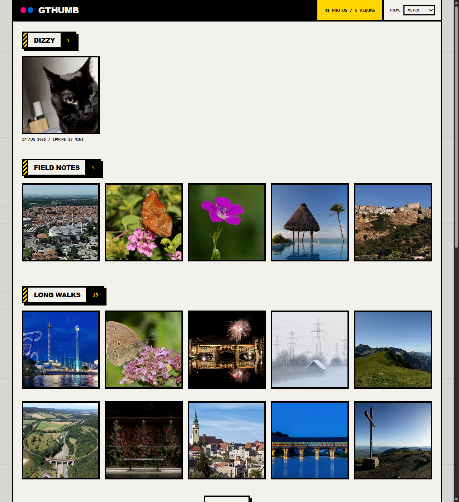

# gthumb

go thumbnail and static website gallery generator

gthumb scans a directory for JPEG photos, applies their EXIF orientation, writes
square thumbnails and display-size copies, and produces a single-page static
gallery (`index.html`) that can be hosted anywhere.



## Usage

```sh
go run . -src examples -out public
```

Each directory under `-src` (including `-src` itself) that contains JPEG files becomes an album. The output looks like:

```
public/
  index.html
  thumbs/<album>/<photo>.jpg   square thumbnails (center-cropped)
  photos/<album>/<photo>.jpg   display-size copies (aspect ratio kept)
```

### Flags

| Flag         | Default     | Description                                       |
|--------------|-------------|---------------------------------------------------|
| `-src`       | `examples`  | directory to scan for albums                      |
| `-out`       | `public`    | output directory                                  |
| `-templates` | `templates` | directory containing `index.gohtml`               |
| `-title`     | `gthumb`    | site title                                        |
| `-thumb`     | `400`       | thumbnail edge length in pixels                   |
| `-max`       | `2048`      | maximum display image edge length in pixels       |
| `-quality`   | `80`        | JPEG quality (1-100)                              |

## How it works

* **Orientation:** the EXIF `Orientation` tag (values 1-8) is read and applied so
  images are stored upright, including phone photos shot in portrait.
* **Metadata:** camera model and capture date (`DateTimeOriginal`) are shown in each
  photo's caption when present. Files without EXIF data are still processed.
* **Thumbnails:** scaled so the shorter edge matches `-thumb`, then center-cropped to a square.
* **Display images:** scaled down to fit within `-max` on the longest edge. Images are never upscaled.
* **Template:** `templates/index.gohtml` is a plain `html/template`, so the layout can be changed without rebuilding.

## Adding a theme

Themes are CSS blocks inside `templates/index.gohtml`. The page offers a Theme
dropdown in the top bar. Only one theme's stylesheets are enabled at a time, and
the choice is saved in the browser's localStorage under `gthumb-theme`.

The shipped themes are:

* `default`: Bootstrap 5 loaded from a CDN, with minimal custom CSS
* `metro`: Flickr-style colors with a brutalist look
* `terminal`: dark, mono-type look

To add a theme (called `mytheme` here):

1. **Add a stylesheet.** Copy an existing `<style>` block, such as `id="theme-terminal"`,
   and give it a new id and `data-theme-style` value. Keep the `disabled` attribute.
   Put the block in `<head>` before the theme-switching `<script>`:

   ```html
   <style id="theme-mytheme" data-theme-style="mytheme" disabled>
     :root { --accent: #ff6600; }
     .photo { border: 2px solid var(--accent); }
   </style>
   ```

2. **Register the name.** Add it to the `names` array in the head script. The saved
   theme is checked against this list, and an unknown name falls back to `default`:

   ```js
   var names = ["default", "metro", "terminal", "mytheme"];
   ```

3. **Add the dropdown option** in `<select id="theme-select">`:

   ```html
   <option value="mytheme">My Theme</option>
   ```

Style the markup with these class hooks:

| Element | Classes |
|---|---|
| Page wrapper | `.site` |
| Top bar | `.topbar`, `.brand`, `.dots`, `.wordmark`, `.toolbar`, `.count`, `.theme-picker`, `.theme-select` |
| Albums | `main.gallery`, `section.album`, `h2.album-title` (`.album-name`, `.album-count`) |
| Photos | `ul.grid`, `li.photo-item`, `a.photo`, `img`, `figcaption` |
| Expand button | `.more`, `.more-btn` |
| Footer | `footer` |
| Lightbox | `dialog.lightbox`, `.lb-btn`, `.lb-close`, `.lb-prev`, `.lb-next` |

Notes:

* The `base` stylesheet, which is always enabled, handles layout that every theme
  needs: lightbox positioning and the `[hidden]` rule for the expand button. Themes
  only need to set colors, type, and decoration.
* Bootstrap utility classes such as `row`, `col`, and `btn` are on the markup for the
  default theme. Other themes can ignore them.
* To load a framework for only your theme, add a `<link>` with the same
  `data-theme-style` value and `disabled`. It is enabled only while your theme is active.

To test, build with `go run .`, open `public/index.html`, and switch themes with the
dropdown. You can also run `gthumbSetTheme("mytheme")` in the browser console.

## Development

```sh
go test ./...
```

## Dependencies

* [bild](https://github.com/anthonynsimon/bild): image decoding, encoding, resizing, and flipping
* [go-exif](https://github.com/dsoprea/go-exif/tree/v3.0.1): EXIF parsing

## References
* https://exiftool.org/TagNames/EXIF.html
* https://pkg.go.dev/github.com/anthonynsimon/bild
* https://github.com/dsoprea/go-exif/tree/v3.0.1
* https://thumbsup.github.io/
* https://www.shopify.com/blog/image-sizes
